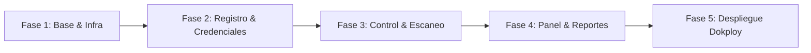

# Plan de Acción — ASMUN Control

> **Proyecto:** Sistema de Registro, Credencialización y Control ASMUN  
> **Cliente:** Colegio Americano de Oruro  
> **Stack:** NestJS · PostgreSQL · Prisma · Next.js 15 (App Router) · Tailwind CSS · TypeScript · pnpm  
> **Referencia:** [SDD.md](file:///d:/DESARROLLO/NESTJS/asmun-control/SDD.md)  
> **Fecha de creación:** Octubre 2026  

---

## 1. Visión General y Objetivos

El objetivo es construir una solución robusta, de alta usabilidad y lista para producción en servidor VPS (Dokploy) para la gestión integral del evento ASMUN (~200 participantes, 4 días de duración).

### Principios de Arquitectura y Negocio
1. **API First & Fuente Única de Verdad:** NestJS (`/api/v1`) concentra el 100% de las reglas de negocio, validaciones y permisos. Next.js actúa como cliente de interfaz responsivo (móvil y escritorio).
2. **Modelo Universal de Puntos de Control:** Ingresos, credenciales, materiales, refrigerios y almuerzos se gestionan uniformemente a través de la entidad `checkpoints` y eventos `scans`.
3. **Concurrencia Garantizada por Base de Datos:** PostgreSQL garantiza la regla de "un solo uso" mediante el índice único parcial `ux_scan_once`, gestionando gracefully las carreras entre escáneres simultáneos.
4. **Privacidad de Menores:** El código QR contiene únicamente el código alfanumérico corto de 6 caracteres; no expone nombres ni datos sensibles.
5. **Simplicidad Operativa:** Respuesta visual inmediata (< 1 s) con semáforo (Verde / Rojo / Amarillo), textos claros, vibración/sonido y respaldo manual por teclado o búsqueda.

---

## 2. Fases de Implementación

### Fase 1: Arquitectura Base, Infraestructura y Autenticación
- **Objetivo:** Inicializar el monorepo con `pnpm`, configurar NestJS y Next.js, modelar el esquema en Prisma con migraciones y levantar el sistema de autenticación RBAC con seed de admin.
- **Entregables clave:**
  - Estructura `pnpm-workspace.yaml` con `apps/api` y `apps/web`.
  - Contenedor local PostgreSQL vía `docker-compose.yml`.
  - Esquema `schema.prisma` completo con enums, relaciones y migración SQL manual para el índice parcial `ux_scan_once`.
  - Módulo Auth en NestJS con JWT (access/refresh), bcrypt/argon2, roles (`admin`, `registrador`, `operador`, `lector`) y guardias de asignación de checkpoints.
  - Interfaz de Login en Next.js con diseño limpio, paleta ASMUN y sesión protegida.

### Fase 2: Participantes, Importación Excel y Credenciales PDF
- **Objetivo:** Gestión completa de delegaciones, comités y participantes, importador masivo resiliente, algoritmo de código corto y motor de generación de credenciales en PDF para imprenta.
- **Entregables clave:**
  - Catálogos de `schools` y `committees`.
  - Generador criptográfico de códigos cortos de 6 caracteres del alfabeto `23456789ABCDEFGHJKMNPQRSTVWXYZ`.
  - Importador con `exceljs`: parser tolerante a variaciones de encabezados de colegios, validación fila por fila con vista previa y reporte de discrepancias.
  - Endpoint y módulo de PDF con `pdf-lib` + `qrcode`: tarjetas 7.5 × 10.5 cm verticales (4 por página A4 con marcas de corte) con fondo de marca de agua, etiquetas de comité/nombre/país/cargo y QR nítido sobre placa blanca.
  - Vistas Next.js: tabla con filtros por colegio/rol, modal de registro rápido en sitio e impresión individual o por lote.

### Fase 3: Motor de Control, Escaneo Móvil y Validación
- **Objetivo:** Implementación del flujo estricto de validación en 6 pasos en NestJS y la experiencia de escaneo móvil ultrarrápida (< 1 s) en Next.js.
- **Entregables clave:**
  - Flujo de validación en NestJS:
    1. Existencia y participante activo (`no_encontrado`).
    2. Rol aplicable (`no_habilitado`).
    3. Ventana horaria (`fuera_de_horario`).
    4. Dependencia de punto previo (`falta_requisito`).
    5. Escaneo previo / restricción única (`duplicado` con detalle de hora y operador).
    6. Registro exitoso (`ok`).
  - Módulo de excepciones y anulaciones (con motivo y auditoría obligatoria).
  - WebApp de escaneo móvil: selector de punto asignado, lector de cámara con `html5-qrcode`/`@zxing/browser`, respaldo por código corto o búsqueda por nombre.
  - Alerta prominente de restricciones alimentarias (`dietary_notes`) en puntos de refrigerio y almuerzo.

### Fase 4: Panel en Tiempo Real, Métricas y Exportaciones
- **Objetivo:** Proveer visibilidad en vivo a organizadores y coordinadores de catering mediante polling cada 5 s y reportes exportables.
- **Entregables clave:**
  - Endpoints de agregación para KPIs: esperados vs. registrados por checkpoint, porcentajes de avance y pendientes por colegio.
  - Dashboard interactivo con tarjetas de métricas, barras de avance y tabla de ausentes/pendientes.
  - Exportador a Excel (`exceljs`) para participantes y registros detallados de escaneo.
  - Vista de auditoría (`audit_log`) para consultar excepciones, anulaciones y reimpresiones.

### Fase 5: Empaquetado Docker, Despliegue Dokploy y Puesta a Punto
- **Objetivo:** Preparar los artefactos de despliegue en VPS bajo Dokploy, variables de entorno, scripts de respaldo y verificación de criterios de aceptación del MVP.
- **Entregables clave:**
  - `Dockerfile` multi-stage para `api` y `web`.
  - `docker-compose.dokploy.yml` optimizado para producción.
  - Seed automático de usuario `admin` y checkpoints base de los 4 días.
  - Checklist de aceptación del MVP ejecutado.

---

## 3. Matriz de Roles y Accesos

| Módulo / Pantalla | `admin` | `registrador` | `operador` | `lector` |
|---|:---:|:---:|:---:|:---:|
| **Dashboard y Métricas** | Total | No | No | Solo Lectura |
| **Participantes (CRUD)** | Total | Total | No | Solo Lectura |
| **Carga Masiva Excel** | Total | Total | No | No |
| **Generación / Reimpresión PDF** | Total | Total | No | No |
| **Puntos de Control (Configuración)** | Total | No | No | Solo Lectura |
| **Escaneo QR / Código Corto** | Sí | Si asignado | Puntos Asignados | No |
| **Excepciones y Anulaciones** | Sí | No | No | No |
| **Reportes Excel** | Total | No | No | Descarga |
| **Auditoría** | Total | No | No | No |

---

## 4. Estrategia de Calidad y Manejo de Concurrencia

1. **Garantía ACID:** Un escaneo genera una transacción o inserción directa protegida por el índice condicional `ux_scan_once`. En caso de conflicto de clave única (Postgres error 23505), el filtro de excepciones de NestJS lo captura e interpreta de inmediato como `{ result: "duplicado", message: "..." }` con código HTTP 200/409 amigable.
2. **Normalización de Códigos:** Todos los códigos se almacenan en mayúsculas sin guiones (`K7P3Q9`). La entrada manual acepta insensible a mayúsculas y limpia guiones o espacios automáticamente.
3. **Optimización Móvil:** Botones táctiles de al menos 48 px de altura, retroalimentación táctil (`navigator.vibrate`) y acústica sintética breve (Web Audio API) para confirmación de escaneo.
